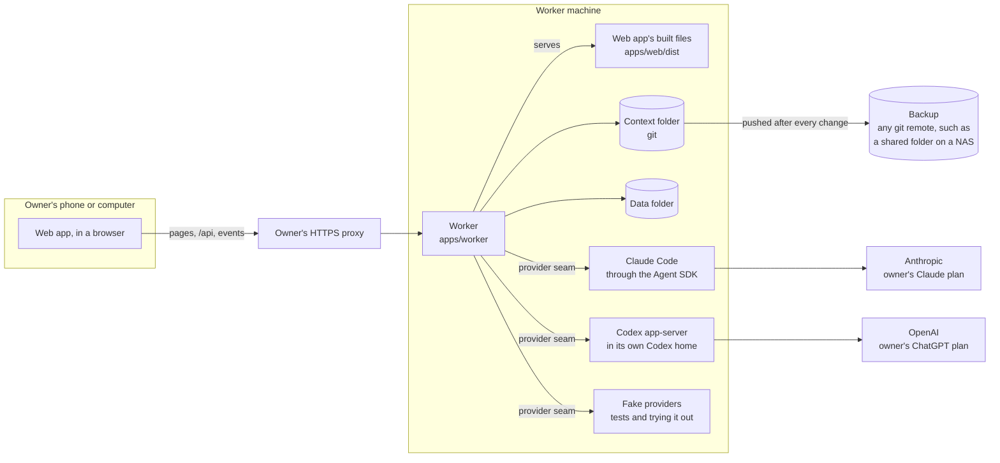
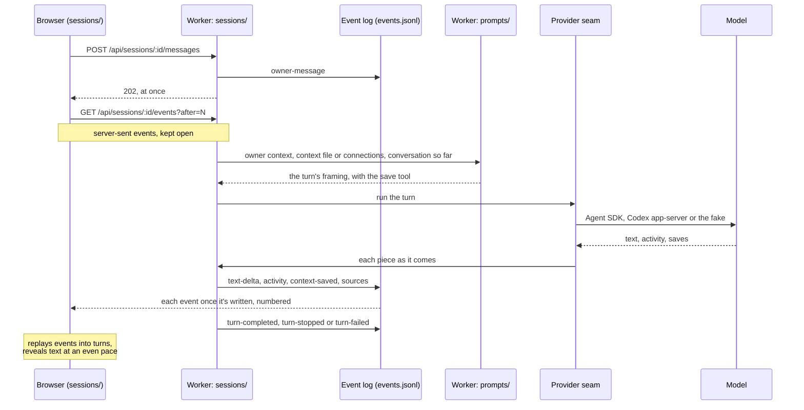

# Architecture

How Courtyard's parts fit together: a map for the owner and for any model working on this repo. What Courtyard does is
in the spec issues on GitHub (the original is [`spec.md`](spec.md), frozen), why it's built this way is in [`adr/`](adr/), and how to run it is in the
[README](../README.md). This map names the parts and how they connect, and links to those for the rest.

[AGENTS.md](../AGENTS.md) (Process) says when a PR updates this map.

## The big picture

Courtyard is two parts. The **web app** is what the owner opens in a browser: it shows things and asks the worker,
and keeps nothing itself but, on a device that turns it on, a read-only copy to read offline
([ADR 0030](adr/0030-the-web-app-may-keep-a-read-only-copy.md)). The **worker** does everything else: it checks the owner's login, keeps the context folder
and the data folder, and runs sessions by talking to providers. Both run from one machine, and the owner reaches them
through their own HTTPS proxy ([ADR 0001](adr/0001-the-worker-owns-everything-the-web-app-is-static-files.md),
[ADR 0002](adr/0002-one-owner-private-network-https-through-the-owners-proxy.md)).

- **One origin.** The worker serves the web app's built files and its API (under `/api`) at the same address, so the
  browser never talks to anything else.
- **Two folders hold everything kept.** The context folder is what models know about the owner and their workspaces;
  the data folder is Courtyard's own working state (sessions, logins, sign-ins). Neither is inside this repo.
- **Providers sit behind one seam.** Claude, Codex and the fakes look the same to the rest of the worker. Claude and
  Codex run on the owner's own subscriptions.

## The parts

Both apps use familiar folder names, listed in the [overview](overview.md). The worker's modules are its features
(`features/<name>/`), plus the provider seam, the prompts, `auth/`, `integrations/`, `config/` and `lib/`: in each,
`index.ts` is what the module does and `routes.ts`, when it has one, is its part of the API. `worker.ts` builds every
module from the settings and wires them together. The web app is pages (`routes/`) built from its features
(`features/<name>/`, a feature named as the worker's where both have it) and shared pieces (`components/`, `hooks/`,
`api/`, `lib/`). The contract package sits between them. Each feature (and each of the worker's `auth/` and
`integrations/` folders, and its `providers/` and `prompts/`) has a README with its detail, linked below. `pnpm check`
fails a folder that isn't one of these, a feature missing from the overview, a README missing or not linked here,
and any folder with more than 15 files: a bigger one is split into parts (#459).

### The worker: `apps/worker/src`

**Starting up**

- **`main.ts`, `start.ts`:** start the worker: build it, then serve it on its port, or say which setting is wrong.
  Idle connections stay open longer than the owner's proxy keeps them, so the proxy never reuses one the worker
  has closed (#204).
- **`config/settings.ts`:** reads and checks the worker's settings from the environment.
- **`worker.ts`:** builds every module and wires them together. Every API request passes its checks (body size,
  same-site JSON only, and logged in, apart from logging in itself). It also holds the routes for workspaces, the
  owner context, backup status and live updates, and serves the web app's files.

**Every module's README.** Each folder below has a README in one shape: what it does, one example, what it uses,
what uses it, and its API, then how it works. This map keeps the big picture; the detail lives there.

*The models*

- [`providers/`](../apps/worker/src/providers/README.md): the provider seam; Claude, Codex and the fakes behind it.
- [`prompts/`](../apps/worker/src/prompts/README.md): everything a model reads, built from [`ai-conduct.md`](ai-conduct.md).

*Talking to the models* (`features/`)

- [`sessions/`](../apps/worker/src/features/sessions/README.md): sessions as event logs, their turns, and a code session's pull request.
- [`saves/`](../apps/worker/src/features/saves/README.md): checks a model's save and writes it; Undo and Edit.
- [`suggested-replies/`](../apps/worker/src/features/suggested-replies/README.md): checks the replies a model suggests.
- [`quick-questions/`](../apps/worker/src/features/quick-questions/README.md): read-only questions about a pull request.
- [`sources/`](../apps/worker/src/features/sources/README.md): a turn's sources, the same for every provider.
- [`limits/`](../apps/worker/src/features/limits/README.md): each provider's usage limit until its reset, and its
  plan usage at a glance (#66).
- [`model-defaults/`](../apps/worker/src/features/model-defaults/README.md): each provider's default model and
  effort, which a new session, a switch of provider and Carry on use (#247).
- [`waiting/`](../apps/worker/src/features/waiting/README.md): what waits on the owner, decided once, and listed
  from every workspace (`GET /api/needs-you`, #492).

*What Courtyard knows* (`features/`)

- [`context-folder/`](../apps/worker/src/features/context-folder/README.md): the context folder as git; every change a commit.
- [`context-file/`](../apps/worker/src/features/context-file/README.md): a context file's sections and lines, text in and out.
- [`owner-context/`](../apps/worker/src/features/owner-context/README.md): `OWNER.md`.
- [`workspaces/`](../apps/worker/src/features/workspaces/README.md): the workspaces, their icons and order.
- [`things/`](../apps/worker/src/features/things/README.md): a planning workspace's Things.
- [`status-line/`](../apps/worker/src/features/status-line/README.md): the status line under a code workspace's
  name, ✓ just done · ● now · ○ next (#256), built from its data; a planning workspace has none (#600).
- [`documents/`](../apps/worker/src/features/documents/README.md): a planning workspace's documents.
- [`floor-plans/`](../apps/worker/src/features/floor-plans/README.md): each room's last floor plan from an answer,
  saved as its document once the answer ends, and Home's plan views (#257).
- [`planning-files/`](../apps/worker/src/features/planning-files/README.md): what documents and Things share.
- [`planning-home/`](../apps/worker/src/features/planning-home/README.md): a planning workspace's Home views, the one
  showing, and its latest session's next steps, which History shows.
- [`changes/`](../apps/worker/src/features/changes/README.md): Recent changes and Undo.
- [`attachments/`](../apps/worker/src/features/attachments/README.md): photos and PDFs sent with a message.

*Building code* (`features/`)

- [`code/`](../apps/worker/src/features/code/README.md): session branches and worktrees, the allowlist, slots and the builds queue.
- [`tasks/`](../apps/worker/src/features/tasks/README.md): a code session's long commands, run on after its turn, its model told when one ends.
- [`preview/`](../apps/worker/src/features/preview/README.md): a code session's running app on a port of the worker's own, behind the login, and its screenshots.
- [`pull-requests/`](../apps/worker/src/features/pull-requests/README.md): a code workspace's pull requests, whoever opened them.
- [`lead/`](../apps/worker/src/features/lead/README.md): builders in the milestone's order, 2 at a time through the night
  within a review budget (#591), and Merge in order.
- [`builders/`](../apps/worker/src/features/builders/README.md): each Lead builder's status, recorded as things
  happen in its session, and its one carry-on.
- [`next-up/`](../apps/worker/src/features/next-up/README.md): ready issues in order, Build, Grill and claims, and the Roadmap.
- [`red-main/`](../apps/worker/src/features/red-main/README.md): a red main after a merge.
- [`version-bumps/`](../apps/worker/src/features/version-bumps/README.md): Dependabot's bumps, re-run once, then filed for the Lead.
- [`repos/`](../apps/worker/src/features/repos/README.md): the owner's GitHub repos as code workspaces, and New repo.
- [`matt-setup/`](../apps/worker/src/features/matt-setup/README.md): the setup check.
- [`matt-skills/`](../apps/worker/src/features/matt-skills/README.md): Matt Pocock's skills from a pinned copy.
- [`workspace-main/`](../apps/worker/src/features/workspace-main/README.md): a code workspace's main, for Home's Main row.
- [`skills/`](../apps/worker/src/features/skills/README.md): a workspace's skills, the more specific winning.
- [`connections/`](../apps/worker/src/features/connections/README.md): a code workspace's GitHub and Paper file.
- [`friction/`](../apps/worker/src/features/friction/README.md): Something's off (#554), friction reported from
  any screen, filed by a session in the code workspace on the live copy's repository.

*Running Courtyard* (`features/`)

- [`live/`](../apps/worker/src/features/live/README.md): the live copy's updates and main's build.
- [`notifications/`](../apps/worker/src/features/notifications/README.md): web push to the owner's devices.
- [`offline-copy/`](../apps/worker/src/features/offline-copy/README.md): the copy a device keeps to read offline,
  `GET /api/offline-copy` (#106).
- [`fresh-start/`](../apps/worker/src/features/fresh-start/README.md): clearing the context folder and setting sessions aside.

*Who may do what* (`auth/`)

- [`owner/`](../apps/worker/src/auth/owner/README.md): the owner's password and device logins.
- [`sign-ins/`](../apps/worker/src/auth/sign-ins/README.md): signing in to providers (Codex).
- [`allow-all/`](../apps/worker/src/auth/allow-all/README.md): whether a code session allows all for this task.
- [`workspace-files/`](../apps/worker/src/auth/workspace-files/README.md): the workspace folder as the edge of what a model reads.

*Other apps* (`integrations/`)

- [`github/`](../apps/worker/src/integrations/github/README.md): the only place that knows GitHub.
- [`paper/`](../apps/worker/src/integrations/paper/README.md): Paper, the first tool connection.

**Helpers: `lib/`**, to reuse before writing a new one (AGENTS.md):

- **`http.ts`:** reads a request's body with a contract schema (JSON with files as a multipart form,
  `readWithFiles`: a message's attachments with `readMessage`, a Thing's photo with its form), and turns errors into
  answers.
- **`files.ts`:** reads, writes (making the folder, with `writeTextFileIn`) and removes files, and JSON checked with
  a schema.
- **`git.ts`:** runs git, never stopping to ask for a password.
- **`commands.ts`:** runs a command line through bash and waits for it, keeping the end of what it printed, and ends
  a process and everything it started (a Codex coding command, #248; a task's keeper, #182).
- **`result.ts`:** the `Result` type.

Beside `src/`, **`apps/worker/test/`** holds the API tests and **`testing.ts`** (a worker on temporary folders, and
helpers for the tests and the context eval), and **`apps/worker/eval/`** is the context eval (see
[The AI setup](#the-ai-setup)).

### The web app: `apps/web/src`

- **`main.tsx`** starts the router, which moves the scroll only for a move to another page (to the top, or back
  to where that page was), never when a page reloads its data (#168). **`routes/`** holds one file per page (TanStack Router; `routeTree.gen.ts` is
  generated). `__root.tsx` checks the worker is reachable, and when it isn't, reads this device's offline copy if
it keeps one (#106), which every page below then reads from; `_app.tsx` is the layout behind the login, with the
  workspaces down the side or across the top; the rest are pages. `_app/index.tsx` is the home page (#102), the
  workspaces as tiles; `_app/settings.tsx` is Settings, with everything that used to be on the home page besides
  them (the owner context, the backup notice, the sign-ins and Connections, Fresh start, logging out other
  devices), behind the frame's Settings sheet. Behind the login
  each page sits in a panel that never scrolls, nor does the window (#266), so the Handheld
  frame stays put; from a tablet up the panel is flat on the frame, with no border or margin, for room on the
  Fold (#503). Every page is `components/layout/page.tsx`'s `Page` (#339): a pinned header (its title, tabs), one
  scrolling middle and a pinned footer (its main action: the message box, Save, Create), so nothing scrolls the
  title or the main action away; on the cover screen the header scrolls with the middle as one column. Only the
  PR page (`features/pull-requests/`) lays itself out, fitting the screen. `components/layout/page-scroll.ts` hands the scrolling middle
  to whatever follows the scroll (a session's turns), and names it to the router, which keeps its scroll per page.
  That middle, and everything else that scrolls (a sheet, the frame's rails, a diff, a wide table), is
  `components/layout/scroller.tsx`'s `Scroller` (#420): a thin thumb, and a fade at its top once scrolled, never a line
  cut in half under what's pinned; the theme check fails anything that scrolls without it. A workspace's page loads its Home's code (code or planning) with its data (`api/workspace-page.ts`), so the page
  shows whole.
- **`api/`** talks to the worker. **`worker.ts`** is how the web app asks the worker: every answer is parsed with the contract's schemas, and an
  offline worker or a refusal comes back as a value to show. A page load waits for a slow worker (`untilAnswered`):
  it's tried again quietly for 30 seconds, and only a refused connection, a network that's down or that long without
  an answer counts as unreachable (#204, #228). **`send-form.ts`**, beside it so it's not on the first load, sends a
  multipart form (a message's files, a Thing's photo) the same way. **`lib/patience.ts`**, also off the first load, sends
  what's harmless to send twice (an approval's answer) and keeps it, tried every few seconds, even once the worker
  counts as unreachable, until it answers (#204). **`worker-watch.ts`** checks the worker's health while a page needs
  it, waiting for a slow worker the same way, so the "can't reach" banner means unreachable, not busy.
- **`features/`**, each one feature's parts, named as the worker's feature where both have it. Each has a README:
  what it does, one example, what it uses, what uses it, and its screens.
  - [`sessions/`](../apps/web/src/features/sessions/README.md): the session page, in parts: `turns/`, `answer/`,
    `composer/` and `notes/`.
  - [`limits/`](../apps/web/src/features/limits/README.md): usage at a glance (#66): the Model sheet's plan meters,
    the warning above the Reply box and Home's usage lines.
  - [`waiting/`](../apps/web/src/features/waiting/README.md): what waits everywhere, for the mark's count, Home's
    Needs you and a session's Next pill.
  - [`home/`](../apps/web/src/features/home/README.md): the home page's Needs you, tile lines and foot rows.
  - [`planning-home/`](../apps/web/src/features/planning-home/README.md): a planning workspace's page, its pills,
    and Home now: the view showing (the Breakdown view, a Thing's photo with every part labelled), no chat.
  - [`new-workspace/`](../apps/web/src/features/new-workspace/README.md): New workspace's form, Planning or Code.
  - [`things/`](../apps/web/src/features/things/README.md): the Things section, a Thing's card and its form.
  - [`status-line/`](../apps/web/src/features/status-line/README.md): the status line under a code workspace's
    name (#256).
  - [`documents/`](../apps/web/src/features/documents/README.md): the Documents section.
  - [`changes/`](../apps/web/src/features/changes/README.md): Recent changes, and Undo after a delete.
  - [`settings/`](../apps/web/src/features/settings/README.md): Settings' backup, owner context and log out others.
  - [`code-home/`](../apps/web/src/features/code-home/README.md): a code workspace's page: Needs you, Running, Next
    up, Main, and its Roadmap tab.
  - [`tasks/`](../apps/web/src/features/tasks/README.md): a code session's running tasks above the Reply box, and
    each ended one's line.
  - [`preview/`](../apps/web/src/features/preview/README.md): a code session's Preview button, and the app beside
    the chat.
  - [`pull-requests/`](../apps/web/src/features/pull-requests/README.md): the PRs list and a pull request's page.
  - [`matt-setup/`](../apps/web/src/features/matt-setup/README.md): the setup card.
  - [`friction/`](../apps/web/src/features/friction/README.md): Something's off (#554): what it fills in at the
    tap, the screen taken in the browser (its code loaded only then), and filing it.
  - [`live/`](../apps/web/src/features/live/README.md): Update, and main's build.
  - [`notifications/`](../apps/web/src/features/notifications/README.md): this device's notifications toggle.
  - [`offline-copy/`](../apps/web/src/features/offline-copy/README.md): Read offline (#106): this device's switch, its
    copy in IndexedDB, kept fresh, and the pages read from it while the worker can't be reached.
  - [`sign-ins/`](../apps/web/src/features/sign-ins/README.md): Settings' sign-ins and Connections.
  - [`fresh-start/`](../apps/web/src/features/fresh-start/README.md): what a fresh start would clear.
  - [`login/`](../apps/web/src/features/login/README.md): the setup and login form.
- **`api/workspace-page.ts`** asks for everything a workspace's page shows; its route's loader imports it, so that
  code and its schemas aren't on the first load. What to show when the worker gives no data is
  `components/layout/problems.tsx`, and how dates read is `lib/when.ts`.
- **`components/`:** Courtyard's shared pieces (buttons, copy buttons, web links, text fields, file pickers, sheets, notices, Connections' cards and so on), used
  on every page ([ADR 0012](adr/0012-courtyards-own-building-blocks-safe-on-the-first-load.md)), in groups by kind
  (#459; [its README](../apps/web/src/components/README.md) lists them): `layout/`, `buttons/`, `forms/`, `sheets/`,
  `frame/`, `chat/`, `code/`, `workspace/`, `photo/` (a photo with its parts pinned, #481) and `rich-blocks/`. One, a table
  heading's sort button (`buttons/sort-button.tsx`), only a rich block uses, so its classes are in `rich-blocks.css` with
  the folder's, and it's styled only inside a `RichBlock`. The pieces that keep a session's flow (#179, #177,
  #168) have a stylesheet of their own too (`chat/chat-flow.css`), added when one first shows and applying only inside a
  `ChatFlowScope`: whose turn it is in a session (`chat/session-state.tsx`, in the chat, a workspace's sessions and the
  recent sessions sheet's, which ask again every few seconds while one is working), the Working line and the Your turn
  mark (`chat/working-line.tsx`), queued messages (`chat/queued-message.tsx`) and Jump to latest (`chat/jump-to-latest.tsx`).
  Nothing jumps in (#269; Paper, "Component · A block that loads late keeps its place"): everything that loads
  after its page uses one shared piece, `layout/kept.tsx`. What it loads is kept in memory for the tab's lifetime, by
  whose it is (`createKept`, `useKept`), so coming back shows the last answer at once and asks again quietly; a
  first visit shows faint rows the size of real ones in the block's place (`PlaceholderRows`, no spinner and no
  words), filled in place, and a block that turns out empty closes up, so only what's below it moves. Its classes
  are in the first load's stylesheet. It holds a code workspace's Home blocks and PRs list, Home's tile lines and
  foot rows, the recent sessions sheet, Recent changes, Settings' Connections and backup, and a pull request's
  page; a page that waits as a whole (a pull request's) shows the rows in its own shape under its title. A
  session's conversation is kept the same way in `sessions/turns/events.ts` (faint rows until its events have come,
  and its stream carries on after what was shown); a diagram once drawn is kept by its source, a drawing still to
  load keeps a faint place rather than showing its code (`components/rich-blocks/fenced.tsx`), and maths keeps its room
  unseen until its formulas can be drawn (`sessions/answer/answer.tsx`).
  The frame round every page is the Handheld frame (`frame/handheld-frame.tsx`, #193; on a computer too since #197),
  loaded after the page with its own stylesheet (`frame/handheld-frame.css`). `frame/handheld.ts` picks its shape by the
  window's width alone, whatever the device: rails from 600 px, the cover-screen layout below. With rails (a
  tablet, the unfolded Fold, a computer, #206): workspace tiles down the left, and down the right labelled buttons (Model, Skills, Add,
  Settings) with the Talk key in the bottom corner; on the folded one, tiles across the top and a bottom bar with
  Type and the talk strip. The page's message box (`sessions/composer/composer.tsx`) offers itself to the frame through
  `frame/handheld.ts`'s dock and moves into it: always there between the rails on a tablet, above the bar once opened on
  the folded Fold. It is the Reply box (#251), the same on every screen: + for a photo or file, a mic that talks as the Talk key does
  (the dock's `talk`) and becomes Send, and the model and effort as quiet text; it opens its Skills and Model sheets
  from the frame's buttons, or Skills from a `/` in the empty box. Something's off (#554) sits in the right rail's
  free space above Talk, or left of Skills on the cover screen; its sheet (`sheets/friction-sheet.tsx`, loaded when
  first opened) isn't modal, so the Talk key, the talk strip, Space and Type go into its You said box while it's
  open, ahead of the page's box, and on the cover screen it floats above the talk row (`--frame-talk`). The talk strip and
  the Talk key (`frame/talk-strip.tsx`, #79, #206, loaded with the frame) share one way of talking: they listen through the
  browser's own speech recognition (`frame/speech.ts`, which also vibrates for it) and put the words in the box as they are
  heard (#198), for the owner to send, or to queue while a turn runs. Holding Space (outside a field) or the
  mouse's side button talks too, and letting go sends (#197), and a letter typed outside a field goes into the box; on a page without a message box,
into the field the page offers instead (`offerField`, New workspace's What's it for?, #264). While it listens, the box shows ✕, ■ and ↑
  in place of + and the mic, keeping its shape. While the owner talks or an answer
  comes, the screen is kept awake (`frame/wake-lock.ts`) where the browser can;
  nothing said reaches the worker except the words. The page stays mounted in the same place whichever frame is
  round it, so folding keeps its scroll and a half-written message. The frame's menus and the box's pickers open as Handheld sheets (`sheets/handheld-sheet.tsx`, #194): from the right edge
  beside the right rail on a tablet, from the bottom on a phone. The box's Skills and Model sheets
  (`sessions/composer/handheld-choices.tsx`, built from `sheets/sheet-choices.tsx`) load only once it's docked; their classes are in
  `frame/handheld-frame.css`. A workspace's icon (#210, `workspace/workspace-icon.tsx`) shows on its tile, the
  home page's tiles and the way back, white or violet while it's open; the icons themselves (`workspace/workspace-marks.tsx`,
  lucide's) load once a page first shows one, off the first load. Change icon in a workspace's ⋯
  (`workspace/workspace-menu.tsx`) opens the Icon sheet (`sheets/icon-sheet.tsx`,
  loaded when first opened): a Handheld sheet. Arrange workspaces (#321): holding a workspace on the rail and
  dragging it up or down within its group saves the order on the worker, and every list of workspaces follows it
  (the cover screen's tiles and Home's, which can't be dragged themselves). Only the press is on the
  first load (`frame/arrange.ts`, with Alt+↑ and Alt+↓ for the keyboard); the drag and the save load with the first one
  (`frame/arranging.ts`). The held one stays in its list as the dashed slot, so a finger keeps its touch on it. A card over
  the page for one task (`layout/card-dialog.tsx`: its title, a line under it and Close) holds Connections, under the line
  that opens it, and the setup card (#323), in the middle of the screen.
  **`hooks/`:** shared `use…` functions, such as `useAction` (`use-action.ts`: an action's busy state and its error,
  #330); a component's own stays beside it. **`lib/`:** small helpers shared by pages. **`styles.css`:** the theme: Handheld, dark whatever the device's setting (#210).
- **`components/rich-blocks/`:** the blocks Courtyard draws in answers and documents
  ([ADR 0021](adr/0021-rich-answers-are-blocks-courtyard-draws-itself.md)), through the answer renderer, so a
  document's page gets them too. Every table sorts by its columns (`table.tsx`, with `sorting.ts` saying how dates,
  prices and text sort), keeping its sort as rows stream in. **The seam for fenced blocks** is `fenced.tsx`: in
  `answer.tsx`, a fence whose language is a kind in its `FENCED_KINDS` (a `chart`, a `mermaid`) becomes a
  `FencedBlock`, which loads that kind's drawing (a module whose default export takes `DrawingProps`: the source,
  whether it's still `arriving`, and the `fallback`) the first time one is needed, never on the first load. The
  fallback is the code block with its problem line, "Couldn't draw this <noun>, so here's what the model wrote", or
  just the source while the block is still arriving; a drawing that throws shows it too. A `chart` block
  (`chart.tsx`) is the JSON the contract's `Chart` schema accepts, drawn by our own SVG as bars, lines or a pie in
  the theme's violet and chart colours by name, its values written on it, and scrolling sideways when crowded; `chart-scale.ts` works
  out its value axis. A `mermaid` block (`mermaid.tsx`) is drawn as a diagram by Mermaid once it has all arrived,
  one at a time, in the colours read from the theme, at its
  own size so a wide one scrolls sideways. A `product` block (`product.tsx`, #245) is the JSON the contract's
  `ProductBlock` accepts, drawn as a card with + Add to wanted, which adds a Thing of that name, wanted, through
  `features/things/`'s call, or ✓ In Wanted once one is. A `plan` block (`floor-plan.tsx`, #257) is the JSON the
  contract's `FloorPlan` accepts, a room in centimetres seen from the front, drawn top-down and to scale by our own
  SVG (`plan-geometry.ts` places each part, and turns the plan when it says why) beside a list of its things by
  side; a tap on a thing or its row lights both up. It says "On Home ✓" once the workspace's Home shows that very
  plan, which the worker saved when the answer ended (`floor-plans/`), and Home draws its plan views with the same
  block, `OnHome` telling it it's in a block whose size is set. Mermaid runs strict, with every one of its settings locked so a diagram's `%%{init}%%` or front matter
  changes nothing, laid out by dagre; `diagram-svg.ts` then takes out of its drawing anything that could still run
  script, load something or go somewhere (links keep their words) before it goes in the page, the one place
  Courtyard puts in markup it didn't write itself. Mermaid itself can still load a picture while drawing (a step
  with an `img`, an actor's icon), so the page's own policy (`index.html`) loads pictures only from Courtyard and
  such a diagram shows as written. The build takes Mermaid from its prebuilt files without its ELK layout
  (`mermaidAsDrawn` in `vite.config.ts`), so it adds nothing to the first load. The folder's classes are
  in its own Tailwind stylesheet (`rich-blocks.css`, which `styles.css` leaves the folder out of), added to the page
  by `stylesheet.ts` (through `lib/stylesheet.ts`) from inside the answer renderer's script, so neither the classes
  nor a stylesheet's name are on the first load. They apply only inside a `RichBlock` (`rich-block.tsx`), which
  each table and drawing is wrapped in, never a fallback: coming after the theme's stylesheet, they would otherwise
  outrank its screen-size variants on every page.
- Beside `src/`: **`public/`** has the service worker (which also shows a pushed notification, unless that
  session is open in front of the owner, and opens the session on a tap, asking the worker which workspace it's in)
  and the install manifest, and **`scripts/finish-build.mjs`**
  runs after each build to stamp the service worker with the files it keeps on install (all but Mermaid's, which it
  keeps once a diagram needs them) and check the first-load budget. `vite.config.ts` keeps everything
  the first load needs in one file, so a lazily loaded module that lazy code loads (a chart) can't split what it
  shares with the first load, such as React and Zod, into files of their own.

### The house skills: `packages/skills`

`@courtyard/skills` holds Courtyard's own skills, a folder each in the Agent Skills format, and `skills.json`: the
kinds of workspace that get each one, whether only the owner starts it (ADR 0016), and its mark in the app (`icon`:
flame, person or the default book; a skill of the owner's gives one as `icon` in its SKILL.md's `metadata`). It also
holds the format check (`checkSkill`, the reference validator's rules in TypeScript), which its own test runs on the
house skills in `pnpm verify` and the worker runs on everyone's. It's a package of its own so it can move to a repo of its own (#88).
`matt.json` pins the release of Matt Pocock's skills code workspaces get (ADR 0024): its version, the checksum of the
copy the worker keeps, the ones the Skill picker lists, and the marks some of them show (`icons`).

### The machine's builds lock: `packages/builds`

`@courtyard/builds` is the one lock every heavy check on the machine takes (#306), so Courtyard's code sessions and
the builds run beside them (a helper's `pnpm verify` in another checkout) take turns rather than lock the machine up
together. It's a folder, `<OS temp>/courtyard-builds` (`COURTYARD_BUILDS_LOCK_DIR` moves it, which only the tests
and the browser tests' workers do), with a file for each place taken, up to `COURTYARD_BUILDS_AT_ONCE`: each made
only if it isn't there yet, naming its holder (a session, or `helper <folder>`), its process and when it took it. A
place whose process has gone is cleared by the next one waiting, so a crash, or a worker restarting, never blocks
for ever; a run that cleared one checks the place it took is still its own once the dust settles, in case two cleared
it at once. The worker's builds queue takes it (`code/builds.ts`) and so does `scripts/builds/run.ts`, which the
root `verify`, `test`, `e2e` and `build` scripts run through: it waits for a place, saying who holds it and since
when, runs the command with `COURTYARD_BUILD_HELD=1` (a run that sees it goes straight through, so `verify` doesn't
wait on itself when it runs `e2e`), and frees the place however the command ends. It's a package of its own, rather
than the worker's, because the repo's scripts need it with no worker running, and nothing else of the worker's.

### The contract: `packages/contract`

Every shape that crosses between the web app and the worker, as Zod schemas with their types inferred, one file per
topic in `lib/`: login, workspaces, sessions and their events (`session.ts` for what the home page needs,
`session-event.ts` for the events, which only the session page parses, and `session-state.ts` for whose turn it
is in each session a list shows and what it waits on the owner for, with what the session page has shown the
owner, which only the pages listing sessions parse), attachments (an event's in `attachment.ts`,
a photo or a PDF by its media type, the limits and checks in `attachment-file.ts`), skills, saves and changes,
usage limits and overflow, plan usage and its warnings (`usage.ts`, #66), sign-ins, the owner's GitHub repos New workspace offers (`github-repos.ts`,
which only that page parses), backup, live updates with main's build, fresh start, the offline copy
(`offline-copy.ts`, #106), health and errors, and a `chart`
block's JSON (`chart.ts`, which a model writes and the web app and the eval check). One piece is no shape:
`command-words.ts` reads a shell command's words as a POSIX shell does, which the worker matches against the
allowlist and the web app summarises a command's activity line from (#285). The worker's
answers are checked against these types;
the web app parses every answer with these schemas.

### Outside the apps

- **`e2e/`:** the browser tests. `start-worker.mjs` starts a real worker on fresh folders with the fake providers,
  the fake GitHub (with two pull requests no session opened, #278, and for a second code workspace, Workbench,
  ready issues in milestones and a helper's pull request, #301), the owner's Paper files in memory (#308), a
  stand-in for Matt Pocock's plugin and a stand-in `gh` that never reaches GitHub;
  `fixtures/context/` is the context folder they start from.
- **`scripts/live/`:** the live copy's scripts, for Windows: start the worker at log on, and update it (ADR 0011).
  The update builds with `pnpm -r build`, never waiting on the machine's builds lock, since Courtyard is down until
  it's done.
- **`scripts/builds/`:** the machine's builds lock for the repo's own heavy scripts (see `packages/builds`).
- **`.github/workflows/ci.yml`:** what `pnpm verify` runs, on every pull request and every push to `main`, split into
  jobs side by side (Checks, Unit tests, E2E in five shards, #587) so a run takes about 5 minutes; `.github/actions/setup`
  is the setup they share.
- **`.github/workflows/roadmap.yml`:** files an issue that comes in without a milestone into `Later` (with
  `needs-triage` when it has no triage label), on filing and once a day, so the milestones stay the whole roadmap.
- **`.github/workflows/matt-skills.yml`:** once a week, runs `scripts/matt-skills/check.ts`, which compares
  `matt.json` with Matt's newest release and, when it's behind, writes an issue with his CHANGELOG lines and the new
  pin (its checksum worked out as the worker checks it); the workflow opens it, once per release (ADR 0024).

## How a turn flows

When the owner presses Send, the worker writes the message down and answers at once. The turn then runs on the
worker to the end, whether or not anyone is watching. Everything the model does is written to the session's event log
first, and only then sent to the browsers following it. The browser draws the session from those events alone, so a
page that reconnects, or opens later, asks for everything after the last event it saw and catches up
([ADR 0006](adr/0006-sessions-are-event-logs-in-plain-files.md)).

Where the rest fits:

- **Saves.** The model calls the save tool its framing offered. `saves/` checks the line and writes it as a change
  through `context-folder/` at once; the session records it and the browser shows a note. A refused save is explained
  to the model, which may put it right once
  ([ADR 0013](adr/0013-models-save-context-as-they-chat-and-the-owner-undoes.md)).
- **Documents.** The model calls the document tool, or the owner taps Save as document under an answer.
  `documents/` checks it and writes it as a change through `context-folder/`; the session records a
  `document-saved` event and the browser shows a note with Open and Undo. Each turn lists the documents; a model reads
  one with the file tools, and that read is what an update is checked against
  ([ADR 0020](adr/0020-documents-and-things-are-files-in-the-context-folder-saved-with-undo.md)).
- **Things.** The model calls the Things tool by the labels its turn listed. `things/` checks the call and writes it
  as a change through `context-folder/`, resizing a photo from the turn's attachments first; the session records a
  `thing-saved` event and the browser shows a note with Open, which goes to the Thing's card
  (`/workspaces/:id/things/:slug`), and Undo. The owner's own adds, edits, deletes and photo uploads, from the
  workspace page's Things section and each card, go through `things/`'s routes, each a change Recent changes can undo
  ([ADR 0020](adr/0020-documents-and-things-are-files-in-the-context-folder-saved-with-undo.md)).
- **The status line** (#256). A code workspace's line is built from `sessions/`' list and `next-up/` when asked, with
  no model. A planning workspace has none (#600).
- **Suggested replies.** The model calls the suggest replies tool its framing offered (planning workspaces only).
  `suggested-replies/` checks them; the session records them as an event and the browser shows them as buttons under
  the latest answer, once its turn completes, until the owner replies. A tap sends one as the owner's message
  ([ADR 0017](adr/0017-models-offer-suggested-replies-through-a-courtyard-tool.md)).
- **Web search.** In every workspace, a model searches the web with its provider's own search and reads pages
  (ADR 0019): Claude through Claude Code's `WebSearch` and `WebFetch`, the adapter's hook allowing a fetch only for a
  page in the turn's search results or a link the owner sent; Codex on cached search, set for its thread. In a code
  session (#517) a helper's searches and fetches go through the same hook, reported as the helper's. Each search
  and page read is an activity. Once the answer is written, the provider hands the worker the turn's sources
  (`sources/`), which the session records as one `sources` event and the browser lists under the answer.
- **Code sessions.** Only a provider that codes works in a code workspace; any other is refused, saying so. A new
  session there starts its session branch and worktree (`code/`) before its first turn, and keeps the branch in its
  `session.json`. Each turn runs in the worktree, with a `CodeTurn` the provider asks before every edit and command:
  Claude's hook asks it for each `Edit`, `Write` and `Bash`, and the fake for each scripted line. A `Bash` call asking
  for the background is a task (#182, `tasks/`): the hook hands it to `CodeTurn.task`, decided as any command (the
  `dev` and `start` scripts allowed only this way), and Claude Code never runs it. The worker runs it under a keeper
  process, on after the turn, its output in `tasks/` in the session's folder, recording `task-started` and
  `task-ended`; one that passes or fails tells the model, in the answer running (a `message-added` with its task), or
  in a turn of its own (an `owner-message` with `tasksEnded`), its last lines of output added for the model alone.
  Its pull request ending, the session deleted or a fresh start stops them; the next worker records those a restart
  stopped. A task whose output prints `http://localhost:<port>` is the session's preview (#183, `preview/`): the
  worker opens one of its own ports (`COURTYARD_PREVIEW_PORTS`) in front of it, letting in only the owner's login
  cookie and passing pages and WebSockets (live reload) through to the app on localhost, and closes it as the task
  ends. Start preview runs the workspace's `preview` command (kept in `workspace.json`) as a task of the owner's
  (`task-started` with `preview`), whose end tells nobody; the model's `preview_screenshot` tool is answered by
  `preview/` with Playwright's Chromium, and shown as an `image-shown` event, as Paper's screenshots are. What's allowed shows
  as an activity (`edited-file`, `ran-command`). A command off the allowlist, an edit outside the worktree, or one to a
  file that decides what allowed commands run (an approval of its own kind, `setup`), is an
  approval (#171): the session records an `approval-requested` event and the `CodeTurn` call waits on it, with no time
  limit (Claude's hook too). Allow or Deny, from any device, goes through `sessions/` and is recorded as
  `approval-answered`, so the browser's card goes everywhere; the first answer stands. A command's approval carries
  what Allow always would allow, when it's offered (`always`, #185), and Allow can answer with it, for the session
  (recorded on `approval-answered`, so the session's later turns read it from its events, and it ends with the
  session) or for the workspace (kept in `workspace.json` as a change to the context folder before the answer is
  recorded); either way the rest of the turn runs it without asking. While the session allows all (#428), a
  command `allowsAll` covers, and an edit to a setup file, runs without asking, its activity marked `allowedAll`;
  an approval it would cover carries `all`, so the card offers turning it on, and turning it on allows each one
  waiting. A stop ends the wait, and a
  denial tells the model why. With six code sessions' turns running, a seventh records `turn-queued` and waits, `turn-dequeued`
  once it starts; `turn-queued` carries how many turns wait ahead of it, recorded again each time it moves up
  (#362), so its `now` is `waiting-for-place` with that count on every screen until it starts. The workspace's
  sessions list marks it `queued`, with how many are running, and deleting it before it starts clears its branch
  and worktree away.
- **The builds queue** (#281). A heavy check the `CodeTurn` allows (or the owner does) waits inside the provider's
  call for its place in `code/`'s builds queue before it's recorded as `ran-command`, recording a
  `waiting-for-build` activity with how many builds are ahead each time that changes (the browser keeps one line
  for it, the latest). A stop ends the wait and leaves the queue. The provider says when each command it ran has
  ended, however it ended (`CodeTurn.ran`: Claude's `PostToolUse` and `PostToolUseFailure` hooks, the fake after
  each scripted command), freeing its place; whatever a turn still holds is freed when the turn ends, completed,
  stopped or failed. The queue is between sessions; the machine's builds lock (#306) is between everything that
  builds on the machine. The build at the queue's front waits for a place in the lock before it starts, still
  `waiting-for-build` (with how many places others hold) while a build outside Courtyard, such as a helper's
  `pnpm verify`, holds them all. A session's commands get `COURTYARD_BUILD_HELD=1`, since each of its builds runs only
  once it holds a place, so the repo's own scripts it runs go straight through rather than wait on that place. A
  heavy check run as a task takes its place the same way before it starts (#589), at the root or in a package, and
  keeps it until the task ends, its commands told it's held; so no check from anywhere gets round the lock.
- **A Lead's builder checks only what it changed** (#589, ADR 0031). Its session's `byLead` mark tells `code/`'s
  command check (`commandAllowed`'s `builder`) to refuse, before anyone is asked, a heavy check asked for as a task
  (`check-in-turn`: checks run in the turn, where the provider's own 10-minute limit on a command holds) and one of a
  whole suite (`ci-runs-it`: `checksEverything`, a `verify` script, or a `test` or `e2e` script, `vitest` or
  `playwright test` naming no test file), each refusal saying why; and its framing tells it so (`prompts/`). The
  owner's own sessions are unchanged.
- **A Lead's builder's status** (#590, #610, ADR 0031). `sessions/` tells `builders/` what happens in a builder's
  session as it's written (a turn starting, an approval, its pull request), as its checks wait, start and end, and
  as a turn ends once its pull request has been looked at; `builders/` keeps one of eight statuses with since when
  in `builders.json`. The Lead decides from it alone (Stuck frees a slot), `sessions/` lists a Stuck builder as
  waiting on the owner with why (Needs you, the Home tile), and the waits end on their own: one carry-on for a turn
  with nothing to show, a turn of the worker's at the usage limit's reset (`carryOnAtReset`), Continue by itself
  once after any restart (`worker.ts`), and a task's end told even while an Update waits.
- **Helpers** (#117, ADR 0027). A code turn's model can start helpers, its provider's own sub-agents, through
  `CodeTurn.helper`: `sessions/` records `helper-started` with its name, gives it a place once fewer than three are
  running (recording it as `waiting` until then, and again once it has one), and hands back a `HelperTurn`, the
  turn's say on edits and commands, tool connections and reports, each recording what the helper does as the
  model's is, tagged with it (`activity` and `approval-requested` carry `helper`), until it reports back
  (`helper-finished`, with its report). Claude's hook starts one for each `Agent` call it allows (Claude Code's own
  types and the repository's), tells each helper's tool calls apart by the id Claude Code gives the helper (from its
  `task_started` message), and hands back its report from the `Agent` call's result; Claude Code puts every helper
  on the session's model. Codex's own sub-agents get none of Courtyard's tools, so Codex starts one for each call to
  Courtyard's `start_helper` (#470): a fresh thread the adapter runs on the session's model and effort, with the file
  and coding tools asked of the helper's `HelperTurn`, its last message its report; with `own_branch` it gets a
  branch of its own through `CodeTurn.branchOff` first. The fake starts one for each line a message scripts. The browser shows one line per
  helper where the model started it, which opens on what it did and its report.
  A helper that writes code works on a branch of its own (#395). `code/`'s `branchOff` makes its worktree beside
  the session's (`<session worktree>-helper-<n>`, on `courtyard/<session branch>-helper-<n>`, from the session
  branch's last commit; `code/branches.ts` names them), the `HelperTurn`'s `workIn` moves its say there
  (`helper-branched`), outside the session's slot so its folder picks its test ports, and with pushing and pull
  requests asking first. As it finishes, `mergeBack` commits whatever it left and merges its branch into the
  session branch in the session's worktree, one merge at a time; merged, its worktree and branch go, and a clash
  aborts the merge and keeps the branch, which the allowlist lets the session's model merge itself.
  `helper-finished` carries `merged`, and the model is told how it went beside the helper's report. A session's
  helpers' worktrees and branches all go when it's cleared away or deleted (`clearHelpers`). With Claude, the model
  asks with the `Agent` tool's `isolation: "worktree"`, and the adapter's `WorktreeCreate` hook makes the worktree
  through `CodeTurn.branchOff` (so Claude Code never makes one in the repository), keyed by the helper id in the
  name Claude Code gives it, and hands it to that helper before its first tool call.
- **Tool connections.** A code workspace that names Paper hands each turn on a provider that uses tools a
  `ToolConnection` from `paper/` (ADR 0023). Claude's adapter passes its MCP server to Claude Code (a command it
  starts, `paper mcp`), its hook asks the connection about each of the server's tools, and its `PostToolUse` and
  `PostToolUseFailure` hooks hand each result back, adding what the worker says to a failure. A delete that asks is
  an approval of its own kind (`tool`), on the same card. Each screenshot is kept in the session's folder beside its
  attachments and recorded as an `image-shown` event, which the browser shows under the answer as a thumbnail, the
  newest of each board, from the attachment route. Every code turn, Paper or not, is told its workspace's
  connections in one line from `connections/`, in place of a context file (#308, ADR 0026): what it has, and what's
  missing and where the owner adds it.
- **Attachments.** A message with photos or PDFs goes as a multipart form: the message's JSON in one field, the
  files in another (with a Thing's photo, the only requests that aren't JSON, and the only ones allowed past the
  small body limit).
  `attachments/` checks them and keeps them in the session's folder; the owner message's event records each one, and
  the browser shows them from the attachment route. Each turn carries the session's last ten: `prompts/` puts each
  PDF's text in the message and lists the photos, which each provider sends its own way (below). They go with their
  session when it's deleted (docs/ai-conduct.md, Attachments).
- **Undo and Edit.** From a save's note, through `sessions/` to `saves/`; or from Recent changes, through `changes/`.
  Each is a change of its own, and the session records what the owner did to its save.
- **Stop.** The worker tells the provider to stop, stops waiting for it at once, and drops anything it sends
  after. What was written so far stays, and the turn is recorded as stopped.
- **Queued messages** (#177). A message sent while a turn runs (waiting for a code session's slot or an approval
  included) is recorded as `message-queued`, its attachments kept already, and every device shows it under the
  turn. Once the turn ends, however it ended, the first still queued goes as its own turn, its `owner-message`
  naming it (`queued`), checked in the session's queue so one removed meanwhile (`queued-message-removed`) never
  goes; after a usage limit they wait for the owner's next turn (Carry on, say). A queued message going first means
  no fixing turn for failed checks starts then (#172), and no "Turn finished" notification goes. One a stopped
  worker left waiting goes once the next worker starts (`recoverAll`). While an Update waits (#186), they hold,
  and go once it has run or no longer waits. The web app's Edit on one removes it and puts its words back in the
  Reply box (#252).
- **Steering** (#252). On a provider whose capabilities say it `steers` (Claude, the fake; not Codex or Fake two),
  a message sent while a turn runs (words only, on the turn's own model, starting no skill) is recorded as
  `message-added` where it was sent, marked `afterApproval` when an approval waits, and put in the turn's inbox
  (`sessions/added.ts`), which the provider takes from through `TurnInput.added` (`AddedMessages`: `next`,
  `waiting`, `read`, `done`). A message's place in the inbox is reserved before it's recorded, and `done` waits
  for any reserved, so one sent as the answer finishes still goes in. Claude's adapter keeps Claude Code's input
  open for the turn and sends each one with `priority: "next"`, so Claude Code folds it in at Claude's next step;
  it says one was read when Claude's next message starts, and is done once a `result` says nothing more is queued
  (`queued_turn_count`). The fake notes each ("noted: …"), and "wait for more" waits for one. Once the provider is
  done, or the turn ends or is stopped, the inbox takes no more: a later message is queued. Each the model never
  read is marked `added-not-read` before the turn's end, and, unless the owner stopped it, queued to go next.
  `prompts/` tells the next turn's model each where it was sent, and a provider that steers is told once that the
  owner may add while it answers. Anything else sent mid-turn (attachments, another model, a skill) is queued.
- **Whose turn it is** (#179). The session page works it out from the events: Working (since the owner's message,
  on the latest activity or the answer), an approval waiting, or the turn's end, marked Your turn. A workspace's
  list of sessions has the worker's say for each (`now`: working, needs-you or your-turn), which the workspace page
  and the recent sessions sheet ask for again every few seconds while one is working or needs the owner. Your turn isn't a new
  reply: whether one waits on the owner is `waiting` on the same list (`waiting/`, #334), cleared once the session
  page has shown the owner its answer, on any device.
- **Usage limits.** A provider fails the turn as rate-limited, with its reset time when it knows it. `limits/`
  remembers that until the reset, and the model pickers show it. Nothing switches model by itself, but whatever has
  no model named avoids one at its limit: a new session, Get to know and a session's title each go to the first
  model with room (for Get to know, the first that saves to context). The worker picks it, not the browser.
  A session whose provider shows as unavailable keeps its model in the picker, and Send waits until the provider is
  back or the owner picks another (#299).
- **Usage at a glance** (#66). Each provider's `readUsage` reads its plan's 5-hour and weekly windows (Claude
  through the Agent SDK's experimental usage call, Codex through its rate limits), asked by `limits/` as the
  worker starts, after every turn ends (`sessions/` says so) and when the Model sheet opens, at most once a minute
  per provider; as a turn runs, its provider hands what it hears of a window to `TurnInput.heardUsage`, which
  `sessions/` passes on with the session. `waiting/` decides the warning from 80% (`GET /api/usage`), which the
  Model sheet, the session page's card and a code workspace's Home show; Switch only changes the Reply box's
  model, before a limit as Carry on does after one. A window a running turn hears cross 80% notifies once.
- **Carry on.** On the last turn, when it failed on a usage limit, the owner can carry on. The session records the
  model change and sends the last message again to another provider's model, with the conversation so far (spec,
  Overflow).
- **Titles.** After the first turn completes, a model gives the session a short title, unless the owner renamed it
  first or Get to know named it.
- **A worker that stopped mid-turn** (#186). As the new worker starts it checks every session (`recoverAll`): a turn
  its log still shows as running is recorded as interrupted (cut off), so the session can carry on, and its next
  queued message, if any, goes. After an update the worker started itself (`live/`'s note), each cut-off turn
  continues by itself; after a crash or the PC restarting, one notification names them ("Courtyard restarted · 2
  turns stopped"), and each waits on the owner (`waiting`: `cut-off`, in Needs you) for Continue: a new turn on the
  same model, told the turn was cut off and what it did, to carry on and check what already happened
  (docs/ai-conduct.md, Every turn). Start again, the old Retry, sends the message again from scratch.
- **Notifications.** Once an `approval-requested`, `turn-completed` or `turn-failed` is recorded, `sessions/` tells
  `notifications/`, which pushes one to each device logged in that turned them on (a stopped turn, and an
  interrupted one found by the next worker, send none of their own: one "Courtyard restarted" names them all, #186). A code turn's end waits for its PR to be followed, so one
  ending with the PR's checks still failing says "Checks still failing: e2e", not "Turn finished" (story 31). The
  service worker shows it and opens the session on a tap. What goes depends on the session's workspace's Notify me
  (#493, `notify` in its `workspace.json`), decided in `notifications/` alone: Everything; Only what needs me, which
  leaves out a turn that just finished unless its answer ends asking the owner something ("Has a question for
  you"); or Nothing.

## Where things live

Everything Courtyard keeps is in two folders outside this repo, named by the worker's settings. The **context folder**
is what models know, and the owner can edit it by hand. The **data folder** is Courtyard's own working state. A few
things live only in the worker's memory and go when it restarts.

**The context folder** (`COURTYARD_CONTEXT_DIR`) is a git repository
([ADR 0009](adr/0009-the-context-folder-is-a-git-repo-with-its-main-copy-on-a-remote.md)):

- `OWNER.md`: the owner context ([ADR 0010](adr/0010-every-workspace-also-gets-the-owner-context.md)).
- `workspace-order.json`: the owner's order for the workspaces (#321), one list of ids for every device; planning
  ones and code ones each keep their own group.
- `<workspace>/CONTEXT.md`: a planning workspace's context file; a code workspace has none (ADR 0026).
  `<workspace>/workspace.json`: its name, mode and icon (and a code workspace's repo, its one line as
  `description`, allowlist changes and Paper connection, with the file's name once connected from its page).
- `<workspace>/docs/<slug>.md`: a planning workspace's documents (ADR 0020), each named by its first `#` heading and
  its file by that name.
- `<workspace>/things/<slug>.md`: a planning workspace's Things (ADR 0020), fields in front matter and a dated
  history, each file named by the Thing's name when it was added; `<workspace>/things/photos/<slug>.jpg`: a Thing's
  photo, resized to fit 1600 px and 300 KB, in plain git.
- `.agents/skills/<skill>/` at the top: the owner's skills for every workspace; `<workspace>/.agents/skills/<skill>/`:
  their skills for one workspace (ADR 0016). Added by hand, so they're kept and backed up like everything else.
- `archived/<workspace>/`: archived workspaces.
- Every change is kept as a commit; hand edits are committed before the next change and every ten minutes. After each
  change the folder is pushed to its backup, `COURTYARD_CONTEXT_REMOTE`: any git remote the owner chooses, such as a
  shared folder on a NAS ([ADR 0014](adr/0014-the-context-backup-is-a-shared-folder-on-the-nas.md)).

**The data folder** (`COURTYARD_DATA_DIR`):

- `sessions/<session>/`: `session.json` (title and times, and a code session's branch, with `keepsBranch` when the
  branch was in the repository before it, #326), `events.jsonl` (the event
  log), `seen.json` (the last event the owner has seen, on any device, #334) and `attachments/`: each photo or PDF the owner attached, by its id, and each PDF's text beside it.
- `matt-skills/<version>/`: Courtyard's copy of Matt Pocock's plugin at the pinned release (ADR 0024): his
  `plugin.json`, licence and skills, checked against `matt.json`'s checksum. `matt-setup.json`: each code workspace's
  answer to the setup check (#181).
- `worktrees/<session>/`: a code session's worktree, its session branch checked out from the workspace's repository
  (ADR 0007). It belongs to that repository's worktree list, so it stays when the session is deleted or set aside by
  a fresh start; it and its branch are cleared away once the session's pull request is merged or closed (#172).
- `repos/<owner>/<name>/`: a GitHub repo New workspace → Code got onto the worker machine for a code
  workspace (#258), a plain clone whose `origin` is the repo on GitHub; the workspace's `repoPath`
  names it. It stays when the workspace is archived, and is used again if the repo is picked again.
- `red-main.json`: what was done about each repository's red main (#355): the commit, its re-run and the issue filed.
- `version-bumps.json`: what was done about each open Dependabot bump (#496): its commit, its re-run, what that
  showed, its "Bump fails" issue and whether Dependabot was asked to rebase.
- `usage-not-now.json`: the warnings before a limit the owner put off with Not now (#66), each until its window
  resets.
- `planning-home/<workspace>.json`: the Home view the owner picked in a planning workspace (#208), which shows while
  it's there.
- `fresh-starts/<date>/`: sessions set aside by a fresh start.
- `owner.json`, `device-logins.json`, `failed-logins.json`: the owner's password, each device's login (only the hash
  of its secret), and recent wrong guesses.
- `github/`: Courtyard's GitHub sign-in (`sign-in.json`) and the `gh` config folder code sessions use (`gh/`),
  holding the token while signed in and a stand-in that works nowhere otherwise (#99).
- `notifications/`: the worker's push keys (`keys.json`) and each device's push subscription, by its device login
  (`devices.json`) (#173).
- `codex/`: the Codex home, holding Codex's sign-in
  ([ADR 0015](adr/0015-codex-runs-through-its-app-server-in-its-own-codex-home-without-a-shell.md)).
  `sign-ins.json`: the providers the owner said Not now to.
- `live-update.json`, `live-update.log`, `worker.log`: the live copy's last update and the worker's output.

**Only in the worker's memory:** usage limits and each plan's usage as last read, and which turns are running.

**On a device that keeps an offline copy** (#106, [ADR 0030](adr/0030-the-web-app-may-keep-a-read-only-copy.md)):
the copy the worker gave it (`GET /api/offline-copy`), whole and read-only, in the browser's IndexedDB (`courtyard`,
its `offline-copy` store), and the switch that it keeps one, in `localStorage`. The worker keeps no list of these
devices. The copy is updated when the app opens or comes back into view and every 15 minutes, and wiped on logging out
on that device, on hearing it's logged out (from another device), or on turning the switch off. While the worker
can't be reached, the root route reads it (its context's `reading`) and the pages' loaders answer from it.

**The other settings** set the worker's port (`COURTYARD_PORT`), point at the web app's built files
(`COURTYARD_WEB_DIR`), name the live copy and its update task (`COURTYARD_LIVE_COPY`, `COURTYARD_UPDATE_TASK`, set by
`scripts/live/`), or switch providers on and off. `apps/worker/src/config/settings.ts` lists them all;
[`.env.example`](../.env.example) explains the ones an owner sets.

**A fresh start** clears the context folder as one change, so its history and the backup still have every file. It
moves every session to `fresh-starts/<date>/`. It keeps the owner's password and
device logins, the sign-ins (the Codex home, Not now and GitHub's) and the usage limits. The README says how to bring things
back.

## The rules that hold it together

Each one is written down once, where the link goes.

- **The worker owns everything:** the web app is static files that show things and ask the worker
  ([ADR 0001](adr/0001-the-worker-owns-everything-the-web-app-is-static-files.md)).
- **One contract:** every shape crossing between web app and worker is a Zod schema in `packages/contract`
  (AGENTS.md, Where code goes).
- **One provider seam:** Claude, Codex and the fakes all sit behind `providers/index.ts`, and only an adapter knows
  how its provider is signed in or billed (AGENTS.md;
  [ADR 0003](adr/0003-claude-through-the-agent-sdk-with-the-owners-login-isolated-per-workspace.md)).
- **Errors are values:** module interfaces return `Result` (`result.ts`); throwing is for bugs (AGENTS.md,
  TypeScript).
- **Dependencies passed in:** the clock, the providers, GitHub, the notification sender, the update command, fetching
  Matt's skills, the repeating jobs and the work nobody waits for (titling a session, notifying the owner) are options
  to `createWorker`, so tests control them (AGENTS.md, Where code goes). Tests wait for that work before removing their
  folders (`removeTestFolder` in `testing.ts`).
- **Three places tests go:** the worker's API in-process and the provider seam (`apps/worker/src/*.test.ts`), and
  the browser (`e2e/`) (AGENTS.md, Tests; spec, Testing Decisions).
- **The first-load budget:** the build fails if what the home page needs first grows past its budget
  (`apps/web/scripts/finish-build.mjs`; [ADR 0012](adr/0012-courtyards-own-building-blocks-safe-on-the-first-load.md)).
  What the first load checks (health, login, the workspace list, errors, a change id) is written in Zod's small
  edition (`zod/mini`, `packages/contract/lib/{health,auth,api-error,workspace-summary,change-id}.ts`); the rest of
  the contract is full Zod, which loads with the pages that use it: `web/src/worker-calls.ts`, and loaders that import
  their page's module when they run (`workspace-page.ts`, `session-page.ts`) (#393).

## The AI setup

Two kinds of model work with this repo, and each has its own files. **Models building Courtyard** (coding agents
working on the repo) read the files in the first list; every repo has these. **Models inside Courtyard** (the ones
the owner talks to in a session) read what the second list builds; only an app that runs models has these.

### Building it with models

- **[`AGENTS.md`](../AGENTS.md):** start here: where code goes, TypeScript, tests, safety and process. `CLAUDE.md` only
  points to it, so every model reads the same file.
- **[`GLOSSARY.md`](../GLOSSARY.md):** the words to use, and the words to avoid.
- **Spec issues on GitHub:** what is being built, written with Matt's `to-spec`; [`docs/spec.md`](spec.md) is the
  original, frozen. **[`docs/adr/`](adr/):** why it is built that way.
- **`docs/architecture.md`:** this map.
- **[`docs/agents/`](agents/):** what Matt's setup writes, kept as he writes it (`issue-tracker.md`,
  `triage-labels.md`, `domain.md`), and Courtyard's two additions: [`roadmap.md`](agents/roadmap.md), the GitHub
  milestones that hold the order of work, and [`process.md`](agents/process.md), the detail behind AGENTS.md's
  Process rules (the next task, claims, when a change needs a board).
- **Skills:** the process is [mattpocock/skills](https://github.com/mattpocock/skills) as it is, installed on the
  machine of whoever works on the repo from Matt's own plugin list, so it updates itself; AGENTS.md's Agent skills
  section says which docs they read. Skills for building Courtyard would go in `.agents/skills/` at the repo's top
  (none yet); how every repo carries this is #88. Inside Courtyard, every code workspace gets his skills from the
  pinned copy instead (ADR 0024).

### Models inside it

Everything Courtyard's models read is built in one place, from written rules, and every provider gets the same text.

- **[`docs/ai-conduct.md`](ai-conduct.md):** the rules for everything a model is told. Read it before changing any of
  it.
- **`apps/worker/src/prompts/`** builds it: each turn's framing, the replies to Courtyard's tools and
  titling. A planning turn's framing and a code turn's differ on purpose (ADR 0032): planning gets its own way of
  answering (Planning answers in the guide) and floor plans; a code turn gets diagrams and the house process. Get to know and Get to know me are house skills in `packages/skills`.
  `context-file/` adds the line labels, and `saves/` checks what the save tool is sent.
- **Each provider passes it on unchanged:**
  - Claude gets it as the system prompt, with Courtyard's tools on one in-process server, and none of the worker
    machine's Claude Code setup, its skills included (ADR 0003). Each turn's message goes as streaming input: one
    message from the owner, its text then each photo as an image. In every workspace it also gets `WebSearch`
    and `WebFetch`, confined as ADR 0019 says. In a code session the framing is appended to Claude Code's own system
    prompt (its `claude_code` preset) instead, with no turn limit
    ([ADR 0025](adr/0025-a-code-session-runs-on-the-providers-own-coding-instructions-with-courtyards-appended.md)),
    and it works in the session branch's worktree with `Edit`, `Write`, `Bash`, `TodoWrite` and `Skill` as well, and
    loads the repository's own project settings (its `CLAUDE.md` or
    `AGENTS.md`) and only the repository's own skills, still none of the machine's setup
    ([ADR 0022](adr/0022-code-sessions-follow-the-repositorys-own-claude-code-setup.md)), and Matt Pocock's skills as
    a local plugin from Courtyard's pinned copy, those the workspace can use turned on by name, which its Skill tool
    loads and its file tools read (ADR 0024). With Paper, Paper's MCP server too, started as a command, its tools
    asked of the worker (ADR 0023).
  - Codex gets it as its instructions, with Courtyard's file tools and other tools as the thread's own, in its own
    Codex home with its own skills and `AGENTS.md` switched off (ADR 0015); each thread starts with every skill Codex
    finds itself turned off, and searches the web on cached mode (ADR 0019). In a code
    session its shell stays off too: it codes with Courtyard's coding tools (`run_command`, `write_file`,
    `edit_file`), each asked of the worker through `CodeTurn` as Claude's hook asks, then done by the adapter in the
    worktree, a command through bash with the session's environment (`lib/commands.ts`); it reads the repository's
    `AGENTS.md` (else `CLAUDE.md`) from the worktree ([ADR 0029](adr/0029-codex-codes-through-courtyards-own-tools.md)).
    [`docs/real-codex-check.md`](real-codex-check.md) checks what's switched off against a real Codex before its
    version changes. Each photo goes with the message as `localImage` input, by its path in the data folder.
  - The fake echoes, and saves, saves a document or a Thing, loads a skill, suggests replies or acts out a web search when a test scripts it, or
    says which attachments it was given ("please look"). In a code session it edits a file ("edit file …") and runs
    a command ("run command: …") when the worker allows, and says why when it doesn't, and updates its task list
    ("update the task list"); a Lead's builder's first message ("Build issue #…") it answers by asking which part to
    start with, so the builder waits on the owner rather than going Stuck (#610). Fake two doesn't code. With
    Paper, it plays Paper ("paper <tool> {…}"), so the browser tests never start the real app.
- **`apps/worker/eval/`:** the context eval runs invented conversations against real Claude or Codex and scores
  their saves, documents and Things, the skills they load, the replies they suggest and whether they search the web. It runs on demand,
  never in CI (`pnpm eval:context`; ai-conduct.md, The eval set).
- **Skills for Courtyard's models** (ADR 0016): the house skills in `packages/skills` and the owner's in the context
  folder, found by `apps/worker/src/features/skills/`, listed on every turn and loaded through the use skill tool, or started
  by the owner, the same on every provider (ai-conduct.md, Skills).

## Where to read more

- The spec issues on GitHub, and [`docs/spec.md`](spec.md), the original spec (frozen): what Courtyard does.
- [`docs/adr/`](adr/): why each big choice was made.
- [`GLOSSARY.md`](../GLOSSARY.md): Courtyard's words.
- [`docs/ai-conduct.md`](ai-conduct.md): what models are told, and how it's checked.
- [README](../README.md): setting it up and running it.
- [`AGENTS.md`](../AGENTS.md): the rules for working on the code.
